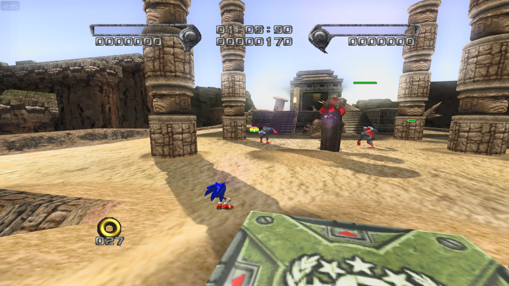
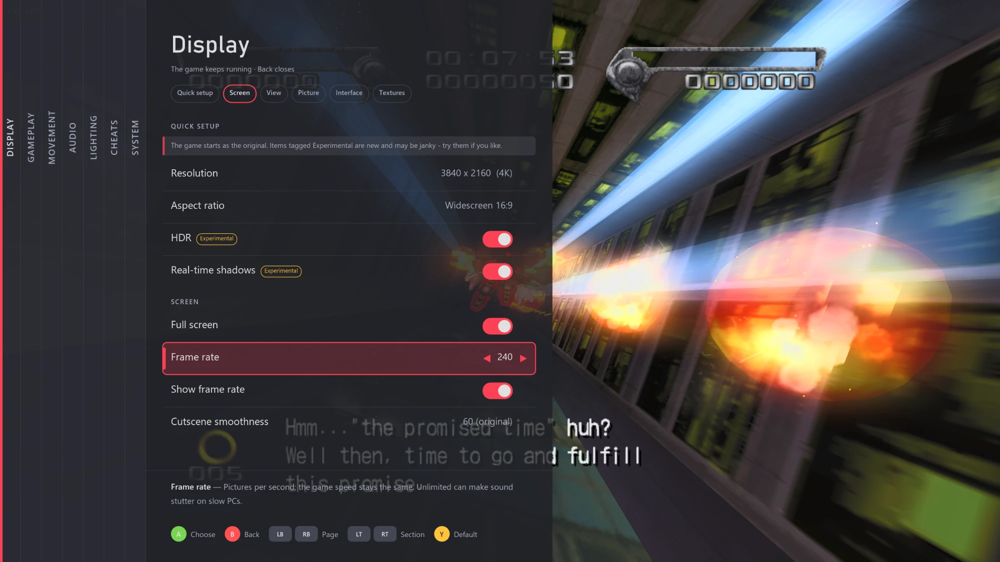
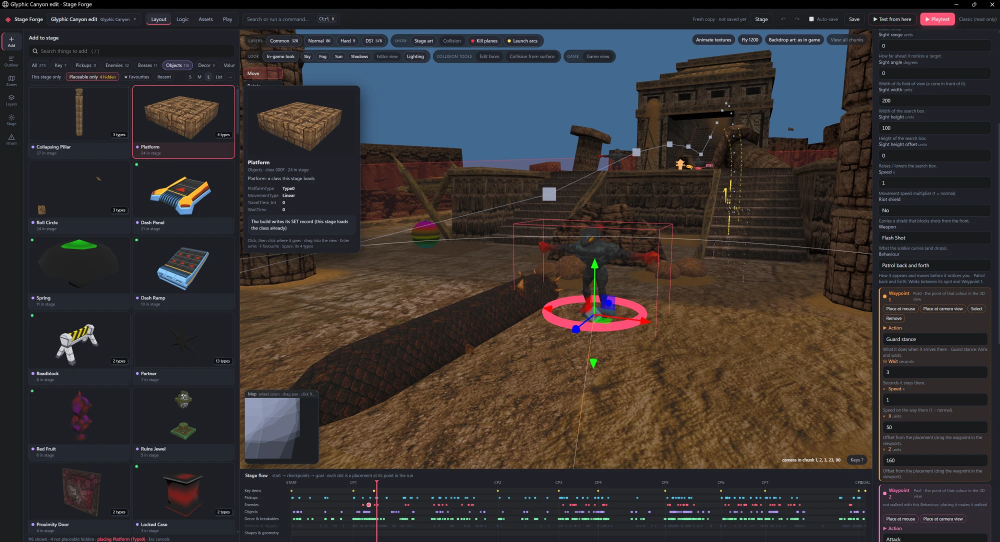

# ShadowRecomp

A PC port of **Shadow the Hedgehog** (GameCube, 2005).

## What this is

- A static **recompilation**, not a decompilation. A tool translated the game's original PowerPC code (about 34,000 functions) straight into C++ that runs natively on Windows, with no emulator. It isn't hand-written, readable source code, and it isn't a "matching" decomp.
- The game logic is that translated original code. Graphics, sound and disc reading are replaced with PC versions. About 160 small hooks add fixes and optional extras, and the "Original game logic" setting turns off the extras that change how the game plays.
- It needs your own legally owned copy of the game. No game files are included.
- It was made for fun, to get the game running natively on PC. It's an unofficial fan project, not affiliated with SEGA, and it's provided as-is.

The project's own code was written by Claude (Anthropic's AI), building on other people's tools and research (see [Credits](#credits)). I gave the instructions and kept the project organised. I'm not claiming I put any real effort or skill into this: I did it for fun because I wanted a good PC version to play. I also can't explain much about how it works under the hood.

## You need your own copy of the game

No game files are included. You need your own legally obtained copy of Shadow the Hedgehog for GameCube (**USA version**).

The first time you start it, it asks for your disc image (`.iso`, `.gcm` or `.rvz`) or a disc folder extracted with Dolphin. It checks it's the right version and sets itself up. After that it starts straight away.

## What's new compared to the original

- Unlimited frame rate: pick anything from 30 to unlimited, and the game still runs at its normal speed
- Higher resolutions
- Widescreen and other screen shapes
- Real-time shadows
- HDR
- Wider field of view and longer view distance
- Optional skip for any cutscene
- Your own texture packs
- Movement tweaks and cheats, if you want them
- An in-game settings menu for all of it
- Controller and keyboard support

**Planned:** anti-aliasing (smoother edges), ambient occlusion, and light sources (lamps, fire, explosions and so on) that actually light up the world around them.

## Settings menu

All the settings live in a menu inside the game. Press **Back** on a controller or **Esc** on the keyboard to open or close it. The game keeps running behind it, and most changes show straight away (the few that need a restart say so).

## Stage editor (work in progress)

There's also a stage editor, Stage Forge, for making your own levels. It's not finished and isn't in the release download yet, so everything here is subject to change.

So far it's been confirmed to:

- Open any of the game's stages and edit them
- Place, move and remove objects and enemies, including ones from other stages
- Import your own 3D models (from Blender as GLB or OBJ) as solid ground
- Add grind rails, moving platforms and kill zones
- Place bosses, more than one at a time
- Set starting rings, lives and a time limit
- Change the music (any track from the game, or your own WAV) and the sky
- Playtest straight into your stage in a few seconds

## Bugs

The major noticeable bugs found so far are fixed (see the [changelog](CHANGELOG.md)). There may still be some: things might look wrong, crash, or behave differently from the original. If you find something, feel free to open an issue, but I can't promise a fix.

**2-player mode hasn't been tested yet.** It's planned, but for now expect it to be broken or not work at all.

## Free to use

It's free. I don't make any money from it and don't want to. Use it, change it, share it, do whatever you like with it.

The project's own code is under the [MIT licence](LICENSE). A few parts keep their own licences: Aurora and three.js (MIT, in their folders), and the stage editor's object list, `tools/stage_editor/catalog.json`, which is based on ShadowSET and so is under GPL-3.0 ([details](tools/stage_editor/catalog.LICENSE.txt)).

The licence only covers this project's own work. Shadow the Hedgehog, its code and its content belong to SEGA and aren't covered by it. This is an unofficial fan project and isn't affiliated with or endorsed by SEGA. Shadow the Hedgehog is © SEGA.

---

## More details

**Supported version:** USA disc, game ID `GUPE8P`, first release (revision 0). European and Japanese versions don't work yet.

**How it works, briefly:** `tools/gen.py` reads the game's `main.dol` from your disc and writes it out as C++ (`generated/`). That's compiled together with a hand-written runtime (`runtime/`) that stands in for the GameCube hardware. Graphics go through [Aurora](https://github.com/encounter/aurora) (WebGPU). The game's data files are read from your disc at run time.

**Building from source (Windows):** you need Visual Studio 2022 Build Tools, LLVM/clang, CMake, Python 3.11+, and `dtk.exe` + `ninja.exe` in `tools\bin\`.
1. Unpack your disc next to the project: `python tools/game_import/gameimport.py <your disc> ..\Shadow`
2. `python tools/gen.py` (creates `generated/` from your own copy; it never goes in the repo)
3. `build.cmd`

## Credits

This project leans on other people's work. Thanks to:

- **[Aurora](https://github.com/encounter/aurora)** (MIT): the GameCube graphics and platform layer the game runs on. Its code is included in `third_party/aurora`.
- **[decomp-toolkit](https://github.com/encounter/decomp-toolkit)**: used to analyse the game's code and make the symbol map in `work/dtk`.
- **[ShadowSET](https://github.com/ShadowTheHedgehogHacking/ShadowSET)** (GPL-3.0): the stage editor's object list (`tools/stage_editor/catalog.json`) comes largely from ShadowSET's research: object and setting names, model lists, and many setting descriptions, some copied word for word. Its notes on the stage file formats were a main reference.
- **[HeroesPowerPlant](https://github.com/igorseabra4/HeroesPowerPlant)** and **[RenderWareFile](https://github.com/igorseabra4/RenderWareFile)**: references for the stage, collision and model file formats.
- **[Dolphin](https://dolphin-emu.org)**: reference for how GameCube hardware behaves (the memory card). Texture pack file names follow Dolphin's custom texture format.
- **[sh05 decomp](https://codeberg.org/ChloeVZ/sh05-decomp)**: reference for the game version and its executable.
- **[three.js](https://threejs.org)** (MIT): the stage editor's 3D view, included in `tools/stage_editor/vendor`.
- The libraries Aurora uses, including Dawn (WebGPU), SDL3 and Dear ImGui. Their licences come with the release download (`NOTICE.txt`).

Apart from the included libraries and the ShadowSET data above, the code here was written for this project, using these projects as references.
